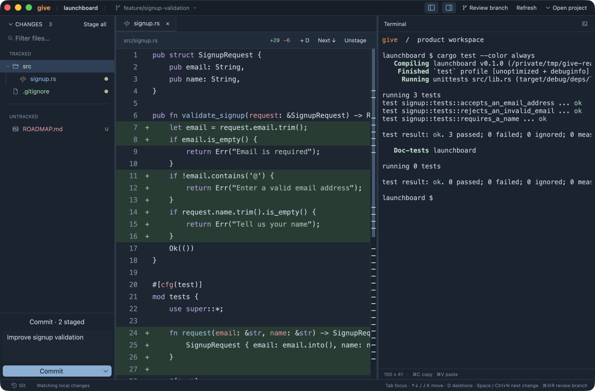
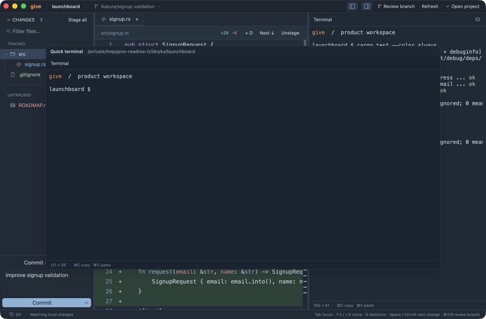
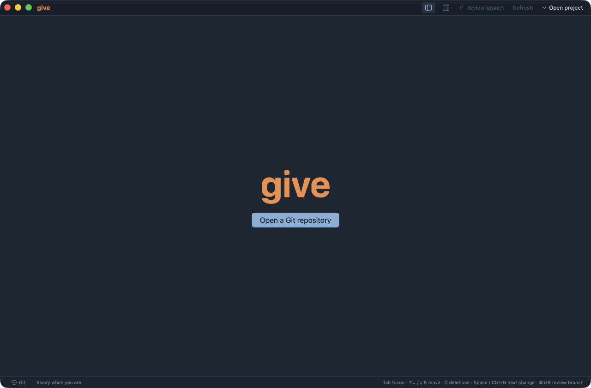

# give

**The terminal-first IDE for product builders.**

Run your tools and coding agents in the terminal. See what changed, review it in context, and take it through Git to a commit and push.

give is an open-source, native workspace that brings a real terminal, live change review, and everyday Git operations into one place. It is built in Rust with [GPUI](https://gpui.rs/), the GPU-accelerated UI framework from the creators of [Zed](https://zed.dev/).



## Built around the way you work

Product work moves between an idea, a command, an agent, a diff, and the next iteration. give keeps that loop visible: your tools do the work in the terminal while the surrounding workspace helps you understand and ship the result.

Open a project and the terminal takes the available workspace. Open a file and its preview appears beside the terminal. Close the last preview and the terminal expands again. Your shell keeps running throughout.

| Capability | What you can do |
| --- | --- |
| Real terminal | Run your shell, CLI tools, development servers, tests, and coding agents on a PTY. Each project has its own session. |
| Quick terminal | Open a separate shell in a centered modal for a short command while the main session keeps running. |
| Live change review | Follow staged, unstaged, and untracked changes in a file tree. Review changes inside the full file, with syntax highlighting and change navigation. |
| Rich previews | Read rendered Markdown and view images and SVGs, with a source toggle where available. |
| Git workflow | Stage files, commit, commit and push, switch branches, fetch, pull, merge, and abort a merge. |
| Branch review | Compare a branch with its base and inspect immutable file versions. GitLab merge request refs are supported through glab. |
| Commit history | Browse reachable commits, inspect their messages and changed files, and copy commit hashes. |
| Context for your tools | Copy paths, line references, or selected code with its location. Paste clipboard images into the terminal as saved file paths. |

## From a working session to a shipped change

1. **Open a repository.** Start your tools or an agent in the project terminal.
2. **Follow the changes.** The file tree updates as the working tree changes. Switch to **Catalog** to browse every non-ignored project file.
3. **Review in context.** Open file previews, find text, jump between changes, and inspect branch history.
4. **Commit and publish.** Stage the files you want, write a message, and choose **Commit** or **Commit + Push** from the button's arrow menu.

Commits use the existing staged index. Commit + Push publishes the current branch with the same name, using its configured push or tracking remote. If the commit succeeds but push fails, give reports the local commit separately so you can retry the push.

### A second shell, when you need it

Click the terminal icon in the shell header to open **Quick terminal**. Run a test, check a command, or inspect a file while your main process continues. Close the modal with **×**, **⌘W**, or a click outside to return to the main terminal.

The quick shell retains its state when you close and reopen it. Project sessions remain available while the app is running.



<details>
<summary>Start screen</summary>



</details>

## Get started

Download a prebuilt package from the [latest release](https://github.com/cjp2600/give/releases/latest). give is in early development; the Linux package is a preview.

| Platform | Download | Installation |
| --- | --- | --- |
| macOS — Apple Silicon and Intel | [Universal DMG](https://github.com/cjp2600/give/releases/download/v0.1.0/give-0.1.0-macos-universal.dmg) · [ZIP](https://github.com/cjp2600/give/releases/download/v0.1.0/give-0.1.0-macos-universal.zip) | Move give.app to Applications. Developer ID signed; notarized by Apple. |
| Linux — x86_64 | [tar.gz](https://github.com/cjp2600/give/releases/download/v0.1.0/give-0.1.0-linux-x64.tar.gz) | Extract and run `./give`. Requires glibc 2.36+, X11 or Wayland, libxkbcommon, and a working Vulkan driver. |

Windows builds are optional and are not included in this release. Install Git and make it available on PATH on every platform. Rust and Xcode are only needed when building from source.

Verify downloads with [SHA256SUMS](https://github.com/cjp2600/give/releases/download/v0.1.0/SHA256SUMS). [Third-party license notices](https://github.com/cjp2600/give/releases/download/v0.1.0/THIRD-PARTY-NOTICES.txt) are included with the release.

### Source requirements

- Git and Rust **1.94 or newer**.
- On macOS, Xcode with the macOS SDK. On Apple Silicon, use an **aarch64** Rust toolchain so native dependencies can load libclang.
- Your usual shell and command-line tools.
- Optional: [glab](https://gitlab.com/gitlab-org/cli) with an authenticated session for GitLab merge request review.

GPUI's runtime shader feature is enabled, so a separate Metal compiler download is not required.

### Run from source on macOS

Clone the repository and launch give:

```sh
git clone https://github.com/cjp2600/give.git
cd give

# Build and launch give.
make run

# Open a project immediately.
make run ARGS=/path/to/project

# Review a branch against its base.
make run ARGS="/path/to/project --review feature/signup"
```

You can also open a repository from the start screen or with **⌘O**.

### Build a macOS app

```sh
# Create an optimized bundle at dist/give.app.
make app

# Build and copy the bundle to /Applications/give.app.
# Quit the running copy before installing.
make install
```

## Keyboard shortcuts

These are the macOS shortcuts. Navigation applies to the focused pane; text fields and terminal programs keep their normal input behavior.

| Shortcut | Action |
| --- | --- |
| **⌘O** | Open a repository |
| **⌘1** | Show or hide the file tree |
| **⌘2** / **⌘B** | Show or hide the terminal while a file preview is open |
| **⌘W** | Close the active preview, or the quick terminal when it has focus |
| **⌘F** | Find text in the active preview or terminal |
| **⌘R** | Refresh the repository or branch review |
| **⌘⇧R** | Open branch review |
| **⌘↵** | Commit staged changes using the message field |
| **Tab** | Switch between tree and preview focus |
| **↑ / ↓** or **J / K** | Navigate the focused tree or source preview |
| **Space** / **Ctrl+N** | Jump to the next change in a source preview |
| **D** | Show or hide deleted lines |
| **⌘C** | Copy selected text, a path, or a source reference, depending on focus |

Open the bottom history panel with **Git** in the status bar or **View → Toggle Git History**.

## Development

```sh
make test    # Unit, GPUI, and temporary-repository integration tests.
make check   # Formatting checks and Clippy.
make fmt     # Format Rust source.
make build   # Build an optimized executable.
make icons   # Regenerate application icon exports.
```

The UI is rendered natively with GPUI and GPUI Component. The terminal uses Alacritty's terminal engine and portable-pty. Git reads, file loading, and syntax work run in the background; file trees and source previews use virtualized lists.

| Area | Source |
| --- | --- |
| Application and workspace | [src/main.rs](src/main.rs), [src/ui.rs](src/ui.rs) |
| Terminal engine and view | [src/terminal.rs](src/terminal.rs), [src/terminal_view.rs](src/terminal_view.rs) |
| Repository and branch operations | [src/git.rs](src/git.rs), [src/branches.rs](src/branches.rs) |
| File previews and caching | [src/preview.rs](src/preview.rs), [src/preview_cache.rs](src/preview_cache.rs) |
| Branch review and history | [src/review.rs](src/review.rs), [src/history.rs](src/history.rs), [src/history_view.rs](src/history_view.rs) |
| Integration coverage | [tests/](tests/) |

For terminal implementation notes, see [research/native-terminal.md](research/native-terminal.md). The original giv renderer supplies the golden fixtures used by the preview tests.

## Contributing

Issues and pull requests are welcome. Bug reports are most useful with reproduction steps, your OS version, and the command or Git state that triggers the problem. Use a small example repository when possible.

For changes to Git behavior, add coverage using disposable repositories. For UI behavior, use GPUI tests where possible. Run `make test` and `make check` before submitting a pull request.

## License

Licensed under the [MIT License](LICENSE).
